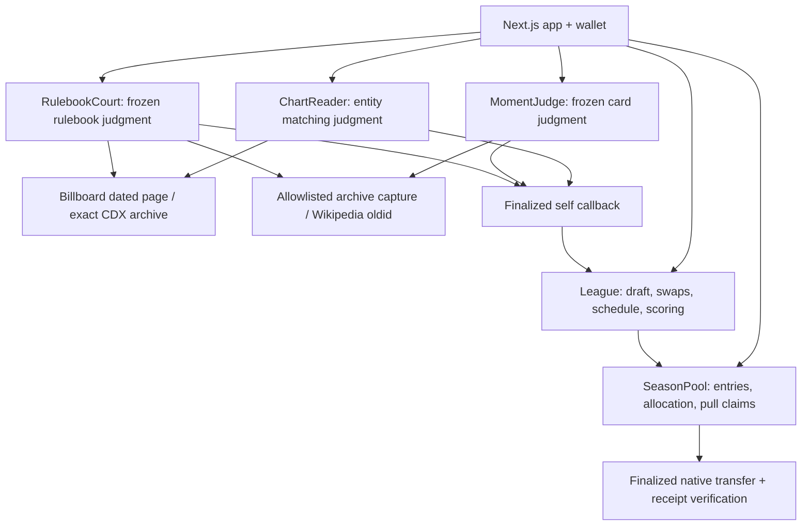

# Hot Roster

**Fantasy football for the Billboard charts, refereed by GenLayer.**

Friends draft five songs, play weekly head-to-head matchups, and challenge chart matches and moment claims against a frozen rulebook. Validators interpret evidence; Python code calculates points, standings and wei.

**Live app:** https://hot-roster-genlayer.vercel.app · **Public source:** https://github.com/JWattjr/hot-roster

## Release status

The real six-week StudioNet season is completed and all 40 entry wei were credited. The existing contracts also host a completed four-week custom-rulebook case: Fortnight drafted under featured artist Post Malone is generically matched, then OVERTURNED under a frozen lead-credit clause, rescored to zero, and its three-point bond returned. No additional GEN deposits or contract redeployments were needed. The strict read-only verifier passes and `completed` / `submissionReady` are true. See the [release report](docs/RELEASE_REPORT.md) and [verification scope](docs/VERIFICATION.md).

## Architecture



The League fixes 4–8 consecutive Saturday dates, 4–8 players, five songs, a card catalog, an entry fee and a SHA-256 rulebook hash. Canonical title/primary-artist pairs are unique. Snake order follows join order; each player can swap once before the chart is locked. A deterministic round-robin produces weekly matchups.

ChartReader extracts all 100 rows in code before calling a model. Validators independently fetch, parse and compare the extraction digest and match vector. MomentJudge requires matching verdicts and verifies the leader's verbatim quote in each validator's own fetch. RulebookCourt re-fetches the same evidence and requires a literal rule clause, evidence passage and matching correction. Self callbacks emitted at native finality expose resolved results to the League.

The scoring table is fixed: No. 1 = 25, positions 2–10 = 15, 11–40 = 8, 41–100 = 3, absent = 0. A debut adds five; a climb of at least ten places adds three. Card points come from the frozen catalog. The model cannot assign points or money.

## Setup

Use Node.js 20.9+ and Python 3.12. The release SDK is pinned to `genlayer-py==0.18.0`, the app to `genlayer-js==1.1.8`, and every contract to runner `py-genlayer:1jb45aa8ynh2a9c9xn3b7qqh8sm5q93hwfp7jqmwsfhh8jpz09h6`.

```powershell
npm ci
python -m pip install -r requirements.txt
npm run dev
```

Open `http://127.0.0.1:3120`. Reading the recorded replay requires no wallet. Signing requires MetaMask or an EIP-1193 wallet on StudioNet 61999. The RPC is `https://studio.genlayer.com/api`; requests include a browser User-Agent. The app keeps demo private keys out of its imports and bundle. `.secrets/`, environment files and Vercel credentials are gitignored.

```powershell
npm run test:contract
npm test
npm run typecheck
npm run build
npm run verify:proof
```

Run `genvm-lint contracts/<name>.py` for each of the five contracts. `verify:proof` is read-only: it uses a disposable caller, never imports the release signer, and compares deployed source, raw final receipts, chart digests, recorded state and native credit. It intentionally fails on incomplete proof.

## Live release and replay

`scripts/release.py` exposes resumable stages: deploy, create, fund, draft, week, moments, disputes, bonds, close, settle, record. Every hash is saved before polling; rerunning resumes that hash. Terminal zero-value adjudication failures are retained separately before a new submission; deposits and pending calls are never resent. Never delete a pending hash to resend. `scripts/replay.py` sequences the remaining stages, preserving the frozen dispute windows.

The demo drafts twenty real songs across May 25–June 29, 2024. It includes actual debuts, climbs and a No. 1 change. Evidence research and saved real HTML fixtures live under `deploy/` and `tests/fixtures/`. The owner approved exactly 42 wei: four 10-wei entries and two 1-wei bonds. Funding and entry receipts are recorded; scripts refuse automatic funding without local approval. StudioNet GEN is simulated currency.

Release calls pass explicit fees. The pinned Python SDK's documented legacy fee path uses `feeValue=0` when this StudioNet endpoint has no FeeManager; a newly charging endpoint stops the script. The frontend passes the legacy fee fields supported by its pinned SDK. Polling is ten seconds, with cached server reads and request limits.

Deploy with a remote Vercel build under `wattxs-projects`; Windows local prebuilt deployment is intentionally unused.

## Limits and recovery

Archive selection uses an exact successful CDX capture of the dated chart URL. A failed archive fetch remains insufficient evidence rather than silently switching sources. Only an empty CDX result permits live-page fallback. HTML structure changes can require a new deployment. The browser receives only rows matching rostered songs and links to Billboard, rather than republishing the complete chart.

The final-week archive.org capture intermittently returns HTTP 503; the finalized judgment that used it is preserved.

Evidence must use HTTPS and an allowlisted original domain, an exact archive `id_` capture inside the chart week verified through CDX, or an English Wikipedia permanent revision. Claims are bounded to three per player/week and each card once per song/week. Embedded instructions are untrusted. Source access or validator disagreement can leave judgments retryable until their deadlines; code then supplies zero chart points or no unresolved bonus.

Closing requires the frozen dispute windows to expire. A points challenger posts three points; pooled leagues also post one wei. A losing challenger forfeits to the song's owner. Inconclusive cases return the bond after the deadline. SeasonPool settles only finalized seasons before the fixed settlement deadline, otherwise makes full entry refunds available. Pull claims reserve an attempt before emitting a native transfer and require an independently checked final parent/child pair before recording paid. A verified terminal failed credit permits the next attempt; an unverified pending transfer cannot be retried safely.

This is StudioNet software. Network availability, native transfer/finality guarantees and evidence accessibility remain dependencies. Neither a browser screenshot nor a passing mock test proves a live adjudication. See the exact verification scope before submitting.

## Submission materials

- [Tutorial](docs/TUTORIAL.md)
- [Two-minute demo script](docs/DEMO.md)
- [Portal fields](docs/submission/portal-fields.json)
- [Proof manifest](deploy/proof.json), [raw receipts](deploy/receipts)

The owner submits to the Portal. This project does not submit automatically.
